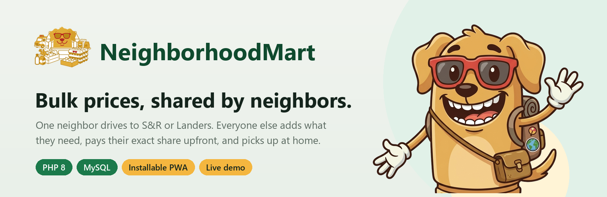
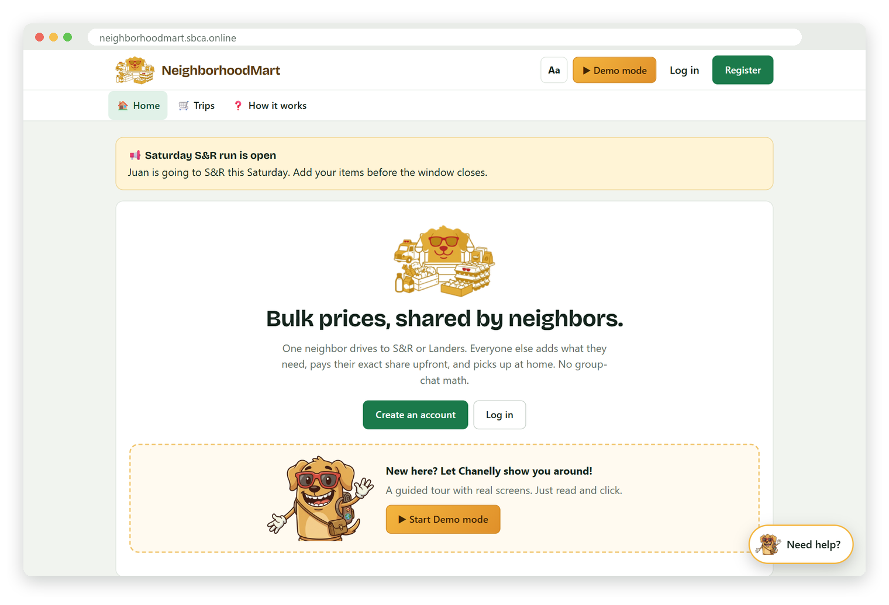
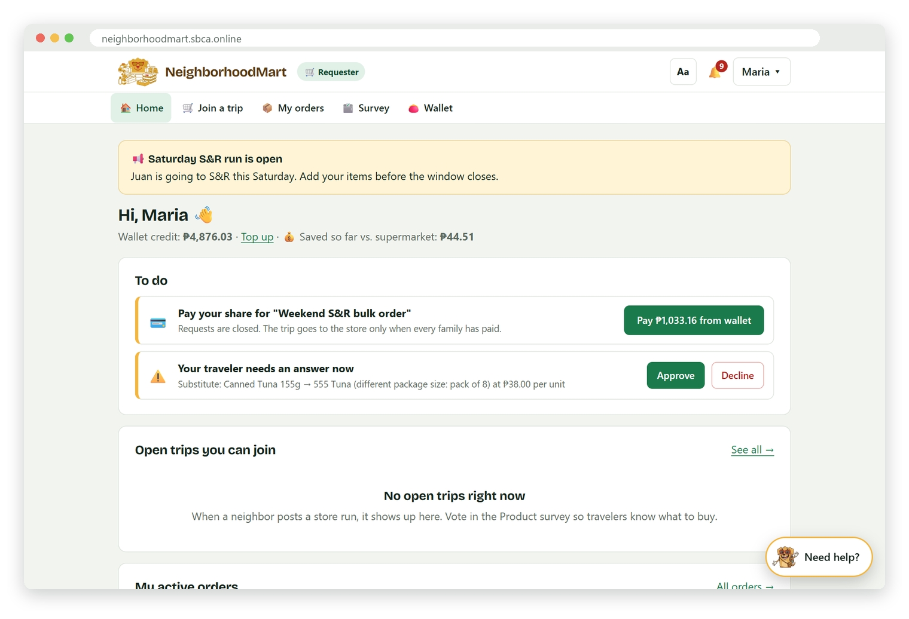
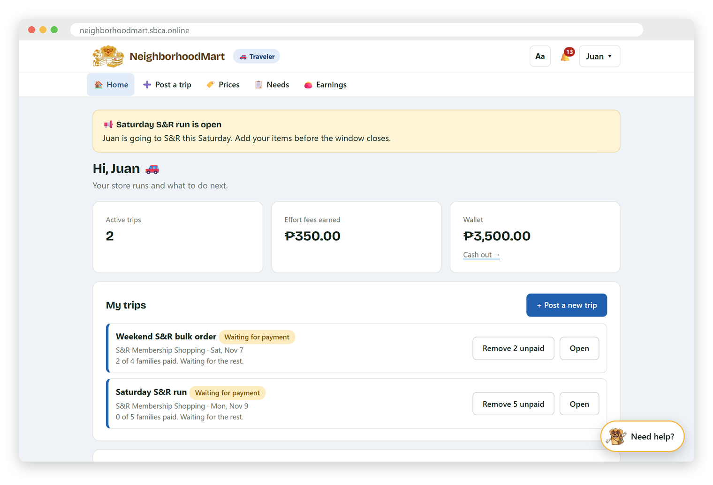
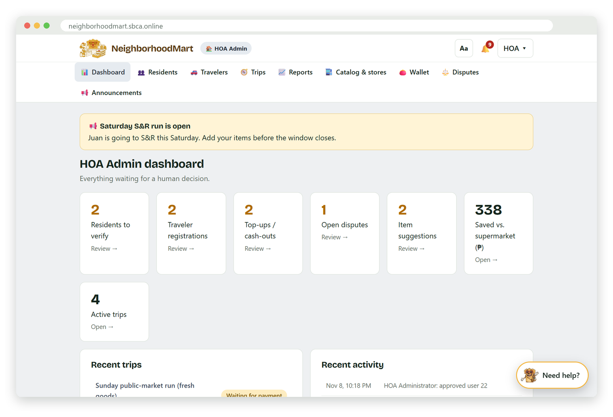
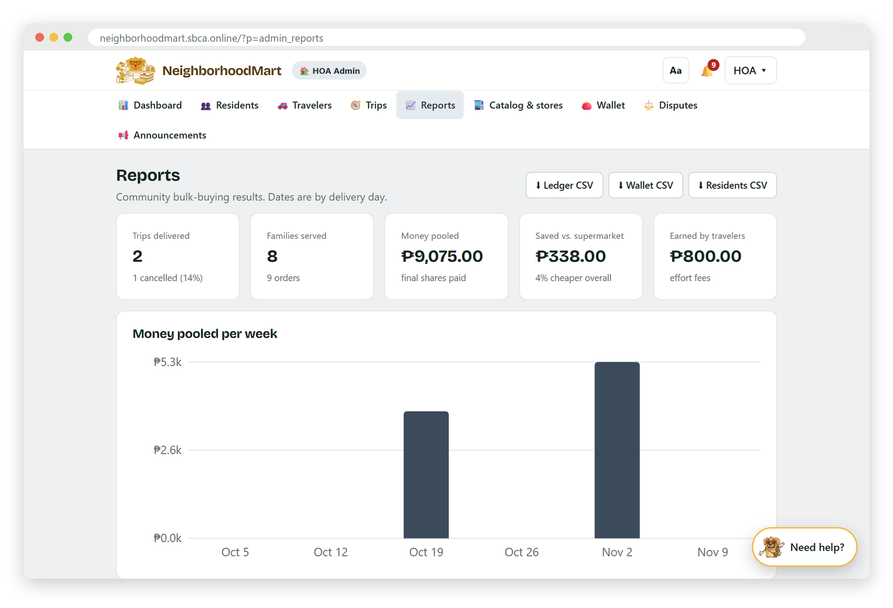
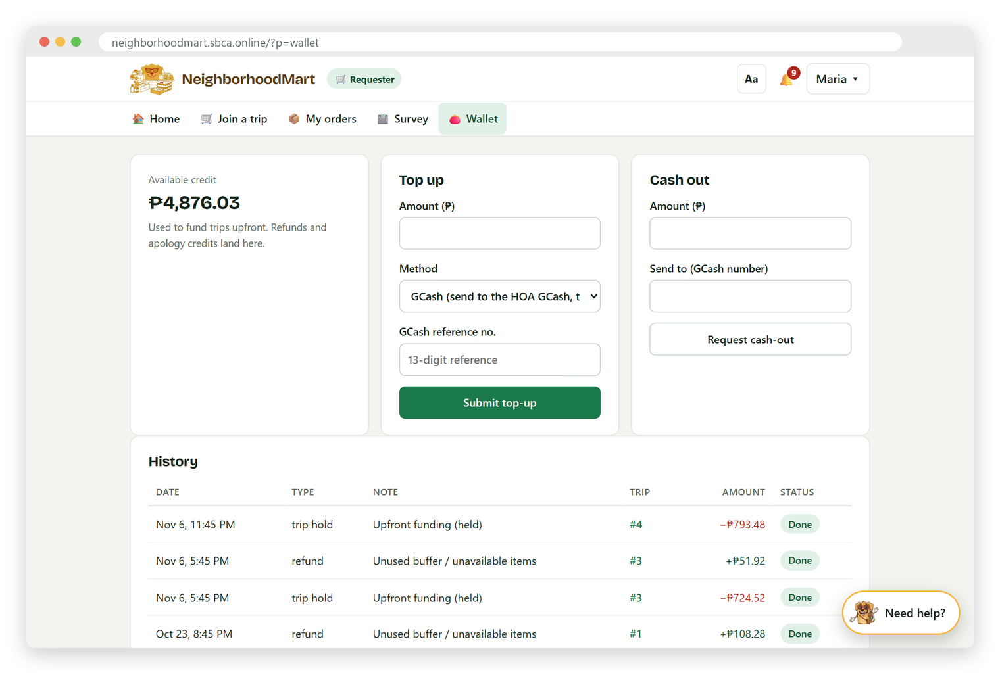
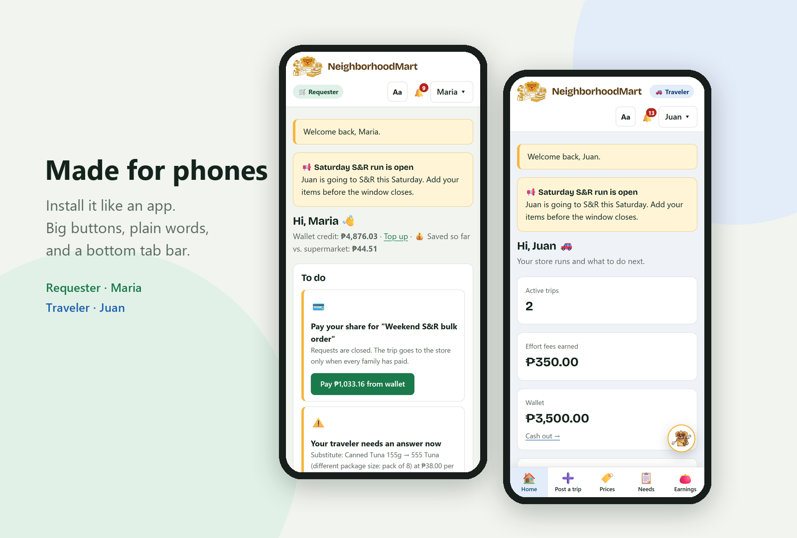
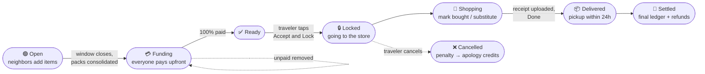

<p align="center">
  
</p>

<p align="center">
  <a href="https://neighborhoodmart.sbca.online"><b> Live site</b></a> ·
  <a href="#-try-the-demo"> Try the demo</a> ·
  <a href="#-getting-started"> Setup</a> ·
  <a href="#-project-structure"> Structure</a>
</p>

<p align="center">
  
  
  
  
</p>

---

**NeighborhoodMart** is a community bulk co-buying web app for a homeowners' association (built for Soluna Executive Village). One verified neighbor, the **Traveler**, drives to a warehouse store such as S&R or Landers. Other residents, the **Requesters**, join the trip, add the items they need, and pay their exact share upfront from a wallet. They pick up their items at home, and nobody has to do the math in a group chat.

Bulk packs get split fairly, so everyone gets warehouse prices without buying a whole case. Trip costs like gas and tolls are shared in proportion to each order. The traveler earns a small effort fee, and the HOA admin can see who is verified, where the money went, and how much the community has saved.

##  Features

| | |
|---|---|
|  **Requesters** | Join an open trip, add items, accept or decline substitutes, pay from wallet credit, pick up at home, and see "You saved vs. supermarket". |
|  **Travelers** | Post a store run (store, date, vehicle, cut-off time), get a shopping checklist, mark items Bought, upload receipts, and track effort-fee earnings. |
|  **HOA Admin** | Verify residents against the HOA master list, approve travelers, confirm wallet top-ups and cash-outs, resolve disputes, post announcements, and view reports and CSV exports. |
|  **Smart pooling** | Matches requests to vehicle capacity, consolidates partial packs, and either rounds them up or trims them so every bulk box is filled. |
|  **Fair math** | Each family pays its items, plus its share of trip expenses, plus a tiered effort fee. A refundable 10% buffer is returned after the receipt is entered. |
|  **Trust & safety** | HOA residency matching, receipt photos that only the right people can view, a 24-hour pickup rule, and penalties if a traveler drops a locked trip. |
|  **Chanelly** | The mascot runs a full guided demo tour, a per-user **Guided mode** that points to the next step, and "Need help?" tips on every screen. |
|  **Easy to use** | Text size A / A+ / A++, Simple view, High contrast, 44px+ tap targets, plain-word statuses, and "Are you sure?" confirmations. |
|  **Installable** | It's a PWA with a manifest and service worker, so it can be added to the home screen on Android or iPhone and has an offline page. |

##  Screenshots

<table>
  <tr>
    <td width="50%"><p align="center"><sub><b>Home</b>: what NeighborhoodMart does, plus a one-click demo</sub></p></td>
    <td width="50%"><p align="center"><sub><b>Requester</b>: a To-do list with pay and substitute answers</sub></p></td>
  </tr>
  <tr>
    <td><p align="center"><sub><b>Traveler</b>: trips, effort fees and next actions</sub></p></td>
    <td><p align="center"><sub><b>HOA Admin</b>: everything waiting for a human decision</sub></p></td>
  </tr>
  <tr>
    <td><p align="center"><sub><b>Reports</b>: money pooled, savings, charts and CSV exports</sub></p></td>
    <td><p align="center"><sub><b>Wallet</b>: top-ups, payments, refunds and credits</sub></p></td>
  </tr>
</table>

<p align="center"></p>

##  How a trip works



### The cost-sharing formula

Each requester's final share (from [`services/allocation.php`](services/allocation.php)):

```
Share_i = C_i + (C_i / ΣC) × F + EffortFee(C_i)
```

- **C<sub>i</sub>**: the cost of family *i*'s items
- **F**: shared trip expenses (gas, toll, parking), split in proportion to each order
- **EffortFee**: tiered on C<sub>i</sub>. It is ₱50 up to ₱499.99, ₱100 up to ₱1,499.99, and ₱150 + 7% above that.

At checkout, each family pays **item estimate + 10% refundable buffer + estimated expense share + effort fee**. The difference is refunded to the wallet after shopping. All of these numbers are set in [`config/config.php`](config/config.php).

## ▶ Try the demo

Open **[neighborhoodmart.sbca.online](https://neighborhoodmart.sbca.online)** and click **Demo mode**. Chanelly walks you through the real app in 5 chapters: a traveler registers, the HOA approves them, a trip gets posted, neighbors join and pay, and the shopping day plays out through to the ledger and savings report.

To explore on your own, use the one-click demo accounts on the login page:

| Role | Username | Password | Who |
|---|---|---|---|
|  HOA Admin | `admin` | `admin123` | Verifies residents and travelers |
|  Traveler | `traveler` | `traveler123` | Juan, S&R runs, sedan |
|  Requester | `requester` | `requester123` | Maria, ₱5,000 credit |
|  Requester 2 | `requester2` | `requester123` | Jose, already in a trip |

The demo data includes one trip at every stage: open, funding, shopping (with a pending substitute), pickup (with an open dispute), cancelled (with apology credits), and done (with the full ledger).

> [!WARNING]
> These are public demo credentials. On a real deployment, set `DEMO_MODE` to `false` and change the admin password straight away.

##  Getting started

**Requirements:** PHP 8.1+ (it uses `match`) with `mysqli` and `gd`, MySQL or MariaDB, and Apache with `.htaccess` support. It runs on XAMPP or shared hosting such as Hostinger. HTTPS is needed for the installable PWA.

1. **Create a database** and user (in hPanel → Databases, or phpMyAdmin on XAMPP).
2. **Import** `database/neighborhoodmart.sql` in phpMyAdmin.
   >  The import drops and recreates all tables. Demo dates are relative to the import time, so open trips stay open.
3. **Configure** `config/config.php`: set `DB_HOST`, `DB_USER`, `DB_PASS` and `DB_NAME`. In production, set `DEBUG` and `DEMO_MODE` to `false`.
4. **Upload** everything to `public_html/`, keeping the folder structure and including `uploads/`. Give `uploads/` permission `755` so PHP can save photos.
5. **Log in** as `admin` / `admin123` and change the password on the Account page.

Upgrading an older database without re-importing it? Run this once:

```sql
ALTER TABLE users ADD guided TINYINT NULL AFTER last_mode;
```

##  Project structure

```
nm/
├── index.php              # Front controller: the only public entry point
├── config/
│   ├── config.php         # DB settings + business rules (buffer, fees, penalties, vehicles)
│   └── routes.php         # Access map: which role can open which page/action
├── core/                  # auth (login, sessions, roles), db helpers, shared helpers
├── services/              # Business logic, one concern per file
│   ├── allocation.php     #   final shares, refunds, ledger
│   ├── consolidation.php  #   pack leftovers, round-up / trim
│   ├── matching.php       #   accept/reject requests (rules R1–R5)
│   ├── pricing.php        #   upfront amount + effort fee
│   ├── trips.php          #   status flow, locks, cancel penalty, 24h pickup
│   ├── verification.php   #   HOA resident matching (fuzzy score)
│   ├── wallet.php · savings.php · charts.php · uploads.php · demo.php
├── actions/               # One file per POST action (pay, lock, upload_receipt, ...)
├── pages/                 # One file per screen
├── views/                 # Layout, role home pages, trip sections, help & guide text
├── assets/                # style.css, app.js, tour.js (demo), guide.js, brand + icons
├── database/              # neighborhoodmart.sql (schema + demo community)
├── uploads/               # Receipt & proof photos (locked by .htaccess)
├── manifest.webmanifest · sw.js · offline.html   # PWA
└── README.txt             # Detailed ops guide: "which one file do I edit?"
```

**How a request flows:** `index.php` loads the core and services, checks `config/routes.php`, then runs a single `actions/<name>.php` (for POST, CSRF-checked) or renders a single `pages/<name>.php` (for GET) inside the layout. Business rules live only in `services/`.

##  Security notes

- CSRF tokens on every POST, plus role-based access control in `config/routes.php`
- Uploaded photos are type-checked by their real file type (JPG/PNG/WEBP/PDF, max 12 MB), auto-rotated, and resized to 1600px
- `uploads/` is blocked from direct access. Photos are served through `?p=receipt` or `?p=proof` only to the HOA admin, the trip's traveler, or a family that paid into that trip.
- Back up `uploads/` together with your SQL export, because the database stores only the file names.

> [!IMPORTANT]
> Don't commit real database credentials. Keep the placeholder values in `config/config.php`, or move secrets out of the repo, before pushing.

##  Tech stack

Plain **PHP 8** with no framework and no Composer dependencies, **MySQL/MariaDB** through `mysqli` prepared statements, and vanilla **HTML/CSS/JS**. It also has a service worker for offline and install support, and SVG charts rendered on the server, with no CDN needed.

##  Credits

Built for the residents of **Soluna Executive Village**. Chanelly the mascot is NeighborhoodMart's own guide. 🐶

<p align="center"><sub>Item prices in the demo data are placeholders.</sub></p>
